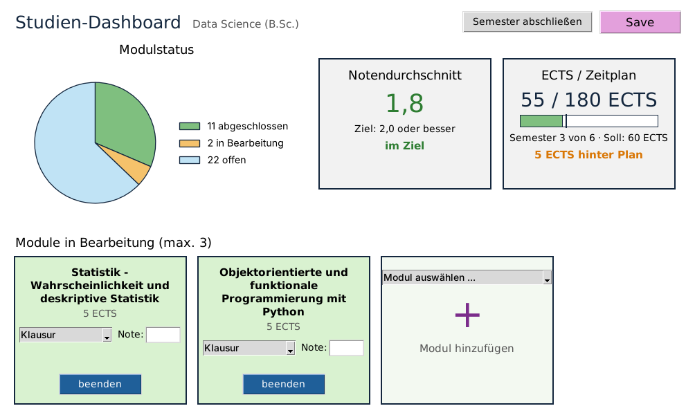

# Studien-Dashboard

Prototyp eines Dashboards für das eigene Studium, entstanden im Portfolio-Kurs
*Objektorientierte und funktionale Programmierung mit Python* (DLBDSOOFPP01_D) an der IU.

Das Dashboard überwacht zwei Ziele:

1. **Notendurchschnitt** von 2,0 oder besser (nach ECTS gewichtet)
2. **Abschluss in Regelstudienzeit**: erreichte ECTS im Vergleich zum Soll-Wert nach den abgeschlossenen Semestern



## Starten

Voraussetzung ist Python 3.10 oder neuer (getestet mit 3.12 und 3.14) von
[python.org](https://www.python.org/downloads/). Tkinter ist dort schon dabei.

**Windows:** Ordner entpacken und `start_windows.bat` doppelklicken. Beim ersten
Start wird eine virtuelle Umgebung angelegt und Matplotlib installiert, danach
öffnet sich das Dashboard direkt.

**Manuell (alle Systeme):**

```
pip install -r requirements.txt
python main.py
```

Beim ersten Start wird `daten/studium.txt` aus den Beispieldaten
(`daten/beispiel_studium.txt`) angelegt. Mit `python main.py andere_datei.txt`
lässt sich eine andere Datendatei öffnen.

## Bedienung

- **+ / Modul hinzufügen:** offenes Modul aus der Liste wählen und auf das Plus klicken. Es können höchstens drei Module gleichzeitig in Bearbeitung sein.
- **beenden:** Prüfungsart wählen, Note eintragen (z. B. `1,7`) und das Modul abschließen. Noten über 4,0 werden nicht angenommen, weil das Modul dann nicht bestanden ist.
- **Semester abschließen:** schließt das aktuelle Semester ab, dadurch steigt der Soll-Wert um 30 ECTS.
- **Save:** speichert alles in die Textdatei. Ein `*` im Fenstertitel zeigt ungespeicherte Änderungen an.

## Aufbau

| Datei | Inhalt |
|---|---|
| `model.py` | Fachklassen: `Studiengang`, `Semester`, `Modul`, `Pruefungsleistung`, `ModulStatus` |
| `speicher.py` | abstrakte Klasse `Datenspeicher` und `TextDateiSpeicher` für die .txt Datei |
| `controller.py` | `DashboardController`, verbindet Oberfläche und Fachklassen |
| `view.py` | Tkinter-Oberfläche: `DashboardApp`, `StatusDiagramm`, `KennzahlFeld` (abstrakt) mit `NotenFeld` und `EctsFeld`, `ModulKarte` |
| `main.py` | Startdatei |
| `tests/` | Unit-Tests für Fachklassen, Speicher und Controller |

Die Tests laufen ohne Oberfläche:

```
python -m unittest
```

## Datendatei

Die Datei ist bewusst eine einfache Textdatei, damit man Werte auch von Hand
korrigieren kann. Jede Zeile ist ein Datensatz, die Felder sind durch `;` getrennt:

```
STUDIENGANG;Data Science (B.Sc.);180;6;2.0
SEMESTER;1;ja
MODUL;1;Einführung in Data Science;5;ABGESCHLOSSEN;Klausur;1.7;2024-03-14
MODUL;3;Big Data Technologien;5;OFFEN;;;
```

Die Werte in den Beispieldaten sind ausgedacht.
